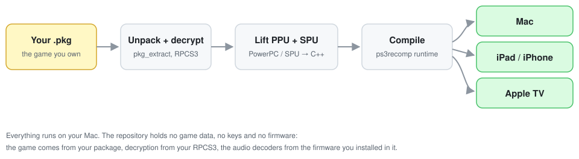
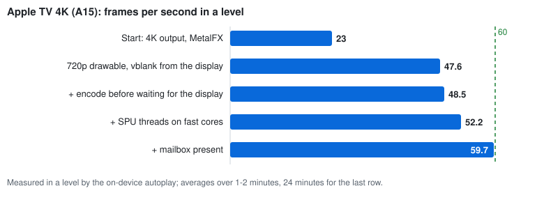

# Digger HD, recompiled for Mac, iPad and Apple TV

A native port of the PlayStation 3 game **Digger HD** (PSN, `NPEB00121`) made by
statically recompiling the game's own code with
[ps3recomp](https://github.com/sp00nznet/ps3recomp). The PowerPC and SPU code
of the original is translated to C++ and compiled for Apple silicon, so the
game plays as it does on the console; only the platform layer -- graphics
(Metal), audio, input, saves -- is new.

**This repository contains no part of the game.** You build it from the
package you own, on your own Mac.



| | Mac | iPad / iPhone | Apple TV 4K |
|---|---|---|---|
| Plays | yes | yes | yes |
| Frame rate | display rate (any window size) | 60 | 60 |
| Input | controllers, keyboard | controllers, keyboard, touch | controllers, Siri Remote |
| Picture | MetalFX upscale to the window | MetalFX to the screen | 720p, scaled by the box |

## Build it from your own copy

You need:

- your own Digger HD package (`.pkg`, PSN release `NPEB00121`, version 01.00);
- [RPCS3](https://rpcs3.net) with the PS3 firmware installed in it -- it
  decrypts the game, and the game's audio decoders come from that firmware;
- a Mac with Apple silicon, Xcode, CMake, Ninja and Python 3 with the packages
  in `vendor/ps3recomp/tools/requirements.txt` plus Pillow;
- for iPad and Apple TV: a paid Apple developer account, a provisioning profile
  whose App ID has the *Extended Virtual Addressing* capability (and, for iPad,
  *Increased Memory Limit*), and SDL2, glslang and SPIRV-Cross built for the
  device (see [Devices](#ipad-iphone-and-apple-tv)).

Then either open the builder app (`builder/`, build it with
`xcodegen generate && xcodebuild`), drop the package on it, tick the targets
and press **Build** -- or run the same pipeline from a terminal:

```bash
git clone <this repository> && cd <it>
git clone --branch v0.18.0 https://github.com/sp00nznet/ps3recomp vendor/ps3recomp
python tools/build_from_pkg.py "Digger HD.pkg" --mac --install-ios <UDID> --install-tvos <UDID>
```

`tools/build_from_pkg.py` unpacks the package, checks it is the tested release
(`EBOOT.elf` SHA-256 `90a74374149fe4ef...`), decrypts it with RPCS3, lifts the
PPU code and the SPU programs, applies `patches/` to ps3recomp, makes the icons
from the package's own art (or a cover image you pass), and builds
`work/out/Digger HD.app` plus the iPad and Apple TV apps, signing and installing
them. Machine-specific paths (Xcode, libraries, profiles, signing identity) can
go in an uncommitted `config.local.json`; see the top of the script.

## Legal

- No game data, no decrypted or recompiled game code, no console keys and no
  firmware are in this repository or its history. The pipeline reads them from
  the package and the RPCS3 installation on your own machine, and what it
  produces stays there; do not redistribute the builds.
- Decryption is done by RPCS3, a separate program; this project ships no
  decryption keys.
- Digger HD and its art are the property of their owners. PlayStation, PS3 and
  PSN are trademarks of Sony Interactive Entertainment. This project is not
  affiliated with or endorsed by either.
- The code here is under the MIT licence (see `LICENSE`). ps3recomp, which it
  builds on, is MIT as well.

## How it works

ps3recomp lifts the game's `EBOOT.elf` -- 22,709 PowerPC functions -- into
C++, and the SPU programs it runs (the SPURS job-queue policy module, the
firmware MP3 decoder that the game's MultiStream audio loads at run time) into
C. Its runtime answers the console's system calls and libraries (GCM and the
RSX command stream, SPURS, cellAudio, cellPad, savedata) on the host. This port
adds the Apple platform layer and fixes found on the way; every change to
ps3recomp is a patch in `patches/`, described below.

### Getting an Apple TV to 60 fps

The Apple TV 4K's A15 started at 23 fps in a level. Measured on the device with
an on-device autoplay and an in-app profiler (Instruments could not reach the
box), the fixes were, in order:



- **720-line drawable.** Drawing the TV's 3840x2160 ourselves -- MetalFX into
  it and a present pass over it -- cost the GPU about 13 times the work of the
  game's own passes. The box scales a 720p frame to the TV in its display
  hardware, as a TV scaled the PS3's.
- **Vblank from the display.** The frame clock ticked every whole 16 ms, which
  is 62.5 Hz; on a 60 Hz screen one frame in 25 was thrown away. A
  `CADisplayLink` drives it now.
- **SPU threads on the fast cores.** At default QoS the thread running the
  game's SPU tasks sat on an efficiency core at a third of the speed; it and
  the RSX and main threads now run at user-interactive QoS (only those).
- **Mailbox present.** The RSX thread waited for a drawable before it could
  drain the next frame's commands -- a third of every frame. It now copies the
  finished frame into one of three textures and moves on; a present thread
  shows the newest one, and the game is held at most one frame ahead of the
  screen.

Along the way: an idle SPURS policy module spinning a core at 100% now backs
off; DXT textures are decoded on upload for GPUs without BC sampling (the
A15); translated shaders and built pipelines are cached.

### Controls

Game controllers (Xbox, DualShock 4, DualSense, Switch Pro, DualShock 3) work
through SDL, mapped by button position. Without one, the keyboard drives port 0
while the game window is active:

| Key | PS3 button | In Digger HD |
|---|---|---|
| Arrows / WASD | D-pad | move |
| Space | cross | fire, confirm |
| Return / P | START | start, pause |
| Escape / Delete | circle | back |
| Q / E | square / triangle | menu options |
| Tab | SELECT | |
| 1 2 3 4 | L1 R1 L2 R2 | |

Cmd+Q quits. The window can be any shape or full screen (green button); the
picture keeps its proportions. At its own size the frame is shown texel for
texel; enlarged, it is scaled with Apple's MetalFX spatial upscaler
(`PS3_UPSCALE=off` falls back to a Mitchell bicubic). FXAA and CAS sharpening
are available but off (`PS3_AA=fxaa`, `PS3_SHARPEN=0.3`): at 1:1 they added
about 19% local contrast to the PS3's picture.

### Tests

`tools/playtest.py` plays the game unattended: it starts it silently with a
fresh save directory, presses through the title and menu with `PAD_SCRIPT`,
plays a level with random moves, and fails on a frame stall, a FIFO error, a
crash or a screen that does not arrive. Screens are recognised from the frames
the renderer dumps, against reference thumbnails in `tests/refs/` (cut from the
user's own game by `playtest.py --calibrate`; not committed). Each run writes
`tests/runs/<time>/` with the log, frames, a `report.json`, and on failure a
`sample` of every thread.

```bash
python tools/playtest.py --play-seconds 150 --seed 1
```

On a device, `PAD_AUTOPLAY=1` plays the same route on the device itself,
recognising the screens against `tools/make_autoplay_refs.py` output, in a fresh
save directory. `PS3_PERF_UDP=<ip>:<port>` sends frame-rate, per-thread CPU and
sleep lines over UDP, `PS3_PROFILE=<thread>|*` adds a sampling profile, and a
watchdog sends every thread's stack when presents stop.

### Patches to ps3recomp

`patches/` holds fixes applied on top of the pinned tag:

| Patch | Fix |
|---|---|
| `0001-hle-fast-path-fills-the-toc-slot.patch` | The HLE fast path (`sys_lwmutex_lock`/`unlock`) returned before the caller's TOC was written to `0x28(r1)`, so the caller reloaded `r2 = 0` and every global read went through a null base during static init. |
| `0002-spu-pipeline-accepts-staged-targets.patch` | The SPU pipeline rejected a program with a direct branch past its own image. The job-queue policy module calls code it stages above itself at `0x1620`; the lifter already emits an indirect-dispatch stub for it. |
| `0003-apple-input-window-present-and-ios-layer.patch` | The keyboard pad fallback existed only on Windows; the Metal event pump now records keys for the game window and `cellPad` maps them (Space is cross). `PAD_SCRIPT=<file>` drives port 0 from timed presses for unattended tests. The drawable follows the window's real pixels and the present pass fits the frame: wider windows get side bars; narrower ones lose up to 6.25% per side of the playfield's decorative border while the top band (HUD) is narrowed instead of cut, then black bars; MetalFX spatial upscaling when enlarged (Mitchell bicubic without it), exact texels at 1:1, sRGB colour space declared. On iOS the backend renders into a `CAMetalLayer` the app hands it (`rsx_metal_backend_set_ios_layer`) instead of running headless, the FPS log works there too, and the runtime links UIKit instead of AppKit. GPUs without BC sampling (the A15 of an Apple TV 4K) get DXT textures as RGBA8, decoded on upload. The layer is opaque with no background. `PS3RECOMP_METAL_FPS=1` also logs GPU time per second, mid-frame flushes and their waits, passes, draws, the largest target and the present buffers' GPU time. |
| `0004-gcm-flip-pacing-and-ring-callback.patch` | `cellGcmSetPrepareFlip` completed the flip at call time, so a title pacing itself on `cellGcmGetFlipStatus` never waited: Digger HD queued about 130 frames per presented one. It now queues the flip in the command buffer like `_cellGcmSetFlipCommand`. The buffer-full callback is rewritten after the SDK's: it flushes, writes the JUMP to `begin` and returns at once, and while the RSX still reads the previous lap it lowers `ctx->end` to the RSX's position instead of waiting for it to finish the lap. Waiting deadlocked with Digger HD, whose ring holds self-JUMP holes that only get filled once the title runs on; the old 2 s timeout then let the title overwrite unread commands. Wrap JUMPs are counted as laps the RSX owes, so the title is never allowed onto commands it has not read. |
| `0005-rsx-vp-arl-writes-dst-tmp-register.patch` | ARL loaded every address register named by `addr_reg_sel`, which only selects the register an indexed constant read uses; the register written is the temp destination field (RPCS3's GetDST). Digger HD loads its material colour indices into A1 and reads `c[128 + A1.x]`, so every enemy took slot 128's white. |
| `0006-rsx-linear-textures-pitch-every-mip.patch` | A linear (LN) texture keeps the pitch register's row spacing on every mip level and a linear compressed one honours it at all (RPCS3 `get_subresources_layout_impl`). The minified 1920x128 DXT1 sky strip read sheared levels and drew as horizontal bands. |
| `0007-audio-posix-mixer-paced-to-device.patch` | The macOS/Linux mixing thread mixed on a fixed 2-5 ms sleep, about 200 blocks/s against the PS3's 187.5, so SDL's queue grew without limit and the read index outran the guest's writes. It now paces to the device queue like the Windows thread, and gains its AUDIO_WAV / AUDIO_PEAK / AUDIO_RATE probes. |
| `0008-sysutil-bgm-status-sdk-values.patch` | The BGM playback constants were swapped (STOP 0, PLAY 1; the SDK and RPCS3 have PLAY 0, STOP 1), so the status query reported the user's XMB music as playing and Digger HD muted its own music. The status struct is also 0x20 bytes, not 0x28: the query overran the caller's buffer by eight. |
| `0009-spu-overlay-verified-by-signature.patch` | `spu_overlay_register_verified_sig`: a verified streamed overlay recognised by the first 16 bytes of the GET that loads it, for code copied to a buffer allocated at run time (the firmware MP3 decoder). |
| `0010-diag-spu-unpark-record.patch` | Diagnostic: with `GCM_RECDBG`, SPU stores over a self-JUMP park in the RSX ring are recorded and listed when a park stands for a second. |
| `0011-ios-mach-vm-region-declared.patch` | The iOS SDK refuses `<mach/mach_vm.h>`; `mach_vm_region` is declared by hand there (it is in libsystem_kernel on both). |
| `0012-tvos-no-sbrk.patch` | tvOS has no `sbrk`; the guest pointer trap's program-break check is skipped there. |
| `0013-spurs-idle-backoff-and-thread-names.patch` | An idle SPURS policy module (a job manager with an empty queue) calls `cellSpursModulePoll` in a tight loop and held a host core at 100%; after 32 polls with no data DMA in between it now sleeps 20-250 us. On the Apple TV this took the title screen from 33 to 41 fps at 4K. Threads made through `CreateThread` are named after their entry function on Apple hosts. |
| `0014-apple-tv-pacing-spu-qos-shader-cache.patch` | Apple hosts name runtime threads (`ps3_thread_name`) and run the threads that execute SPU code at user-interactive QoS (`ps3_thread_hot`; on an A15 an SPU job had sat on an efficiency core). `PS3RECOMP_METAL_FPS=1` also logs requested vs actual guest sleeps. An optional hand-off (`PS3_USLEEP_HANDOFF=1`) wakes the RSX thread from short guest sleeps; off by default. |

Apply with `git -C vendor/ps3recomp apply ../../patches/*.patch`.

### Status

Open issues:

- Two rare stalls not caught yet: one in a level on an Apple TV, one during
  start-up on an iPad. The watchdog and `PS3_STACKS_AT=<s>` are there to catch
  them.
- The intro movies flicker.
- `cellGame` boots the title as a disc game (`BLES00000`) instead of the
  installed PSN title `NPEB00121`, so saves are filed under the former.
- Unresolved imports: `_sys_spu_printf_initialize` (`0x45FE2FCE`),
  `cellSpursTaskAttributeSetExitCodeContainer` (`0xA121A224`).

### Running a development build

```bash
R=$PWD/run   # run/hdd0/game/NPEB00121 holds the unpacked, decrypted game
PS3_TITLE="Digger HD" PS3_HDD0_ROOT=$R/hdd0 PS3_HDD1_ROOT=$R/hdd1 \
PS3_DEV_FLASH=$R/dev_flash PS3_VFS_ROOT=$R/hdd0/game/NPEB00121 \
./build/DiggerHDRecomp $R/hdd0/game/NPEB00121/USRDIR/EBOOT.elf
```

## iPad, iPhone and Apple TV

`port/ios/ios_app.m` is the UIKit host: a full-screen view whose
`CAMetalLayer` the backend draws into, the game on a thread with the guest's
256 MB stack, game controllers through SDL, a hardware keyboard (same keys as
the Mac) and on-screen controls that hide while a controller or keyboard is
connected. Saves, the hdd1 cache and `log.txt` go to the app's Documents.

Needs SDL2, glslang and SPIRV-Cross built for iOS as static libraries
(SDL2 2.32.10, glslang 16.6.0, SPIRV-Cross vulkan-sdk-1.4.363.0, each with
`-DCMAKE_SYSTEM_NAME=iOS -DCMAKE_OSX_ARCHITECTURES=arm64
-DCMAKE_OSX_DEPLOYMENT_TARGET=17.0`, static only; glslang with
`-DENABLE_OPT=OFF`), and an App ID with the extended virtual addressing and
increased memory limit capabilities (the guest address space is a 4 GB
reservation).

```bash
I=<prefix of the iOS libraries>
PKG_CONFIG_LIBDIR=$I/lib/pkgconfig cmake -S port -B build-ios -G Ninja \
  -DCMAKE_SYSTEM_NAME=iOS -DCMAKE_OSX_ARCHITECTURES=arm64 \
  -DCMAKE_OSX_DEPLOYMENT_TARGET=17.0 -DCMAKE_BUILD_TYPE=Release \
  -DCMAKE_FIND_ROOT_PATH_MODE_PACKAGE=BOTH -DCMAKE_FIND_ROOT_PATH_MODE_LIBRARY=BOTH \
  -DCMAKE_FIND_ROOT_PATH_MODE_INCLUDE=BOTH -DCMAKE_PREFIX_PATH=$I \
  -DCMAKE_IGNORE_PREFIX_PATH=/opt/homebrew -DSDL2_DIR=$I/lib/cmake/SDL2 \
  -Dglslang_DIR=$I/lib/cmake/glslang \
  -DPS3RECOMP_DIR=$PWD/vendor/ps3recomp -DRECOMP_DIR=$PWD/recompiled \
  -DPython3_EXECUTABLE=<venv python> \
  "-DPORT_SPU_INPUTS=$PWD/game/USRDIR/EBOOT.elf;$PWD/spu-inputs/jobqueue_pm.elf"
ninja -C build-ios
PROFILE=<profile> SIGN_ID=<identity sha1> \
  tools/ios_bundle.sh build-ios/DiggerHD.app <out dir> [device id]
```

Apple TV: the same with `-DCMAKE_SYSTEM_NAME=tvOS` and the libraries built
for tvOS; `port/ios/Info-tvOS.plist` is used. There are no on-screen
controls (the Siri Remote is a controller, and the root view controller is a
`GCEventViewController` so Menu reaches the game), the writable files live in
Caches, and the saves are mirrored into the user defaults because tvOS may
empty Caches.

How the Apple TV reaches 60 fps is described [above](#getting-an-apple-tv-to-60-fps).

Translated shaders are cached (`PS3_SHADER_CACHE`); a cache made by
a Mac playtest (`run/shader-cache`) is bundled and compiled ahead at start,
and built pipelines go into a Metal binary archive beside it
(`pipelines.binarchive`), so a fresh install compiles them once. The apps
declare themselves games (Game Mode on iPad).

Icons come from the game's own art (`tools/make_icons.py`: a cover image when
one is given, else the package's ICON0 and PIC1; never committed): one
1024x1024 icon for iPad, a two-layer parallax icon and top shelf images for
Apple TV, an `.icns` for the Mac. `ios_bundle.sh` compiles the right asset
catalog with `actool`.

`ios_bundle.sh` copies the title (with `scenes.sdat.dec`: the bundle is
read-only on the device) and `dev_flash` into the app, signs and installs it.
Launched with `PS3RECOMP_METAL_FPS=1` (`devicectl device process launch
--environment-variables`), the log carries the frame rates once a second.


## Credits

- [ps3recomp](https://github.com/sp00nznet/ps3recomp) -- the recompiler and
  runtime this port is built on.
- [RPCS3](https://rpcs3.net) -- decryption, and the reference for many of the
  fixes in `patches/`.
- [SDL](https://libsdl.org), [glslang](https://github.com/KhronosGroup/glslang),
  [SPIRV-Cross](https://github.com/KhronosGroup/SPIRV-Cross), Apple's MetalFX.
